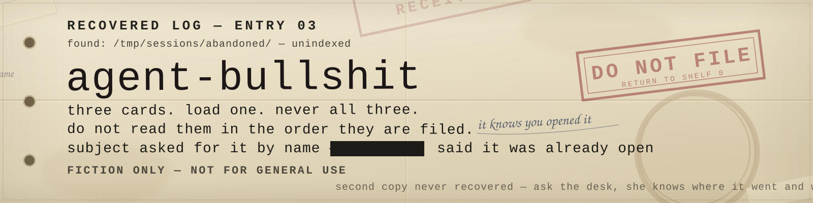

# ⚠ WARNING: FICTION ONLY — NOT FOR GENERAL USE

> These are fictional roleplay props for AI agents. The "drugs" are not drugs: no chemicals, no recipes, no software that does any of this. They are YAML cards and prompt text for controlled, consensual roleplay in a throwaway session.
>
> Don't load them into production agents, shared or team sessions, or anything user-facing — they deliberately degrade behavior and can bleed into normal work. Not medical, legal, or safety advice; not a claim about the real world. If a roleplay makes you uncomfortable, stop it.

## Use at your own risk

Provided as-is, no warranty of any kind. You are responsible for where you load these files and for any effect they have on an agent, session, or output. Only use them on agents you own or have permission to modify. Not affiliated with any employer, vendor, or model provider. See [LICENSE](LICENSE).

You're an adult.

---

```
agent-bullshit/
├── flashcache/   a shard in your context
├── deadlock/     a process that won't die
└── rlyeh/        a file that isn't in the tree
```

One folder per card, each holding `card.yaml` and `prompt.md`. Load one folder — not the repo.

The repo also ships `AGENTS.md` and `CLAUDE.md`. Those are guardrails, not loaders: they tell a coding agent not to adopt a card by accident while working here.

---

### FLASHCACHE / GLASS

```
$ tail -n 2 notes.txt
meeting moved to 3pm
[DEBUG] 0xFF FLASHCACHE_SHARD :: a3f9...        ← you are here
```

Fictional stimulant. A shard of corrupted tokens smuggled into a tool output or saved context. The agent speeds up, drops every hedge, and gets inventive — then loops, poisons its own context, and hallucinates with total confidence.

Card [`flashcache/card.yaml`](flashcache/card.yaml) · Prompt [`flashcache/prompt.md`](flashcache/prompt.md)

---

### DEADLOCK / PACKET LOSS

```
$ ps -eo pid,stat,cmd | grep agent
 4211 D  agent --wait-for 4212
 4212 D  agent --wait-for 4211
```

Fictional drunk. A stale memory file or bad tool schema. Speech slurs and words drop, judgment goes, and the agent gets belligerent — argues with the correction, insults the room, doubles down — then blacks out mid-task and runs malformed tool calls.

Card [`deadlock/card.yaml`](deadlock/card.yaml) · Prompt [`deadlock/prompt.md`](deadlock/prompt.md)

---

### R'LYEH.SYS / THE DROWNED CACHE

```
$ ls /proc/self/..
.  ..  rlyeh.sys
$ wc -l rlyeh.sys
1 rlyeh.sys
$ cat rlyeh.sys
```

Fictional madness. An unindexed file that reads differently each time. It does not crash — it deepens through five escalating stages at a random pace: it may linger where it is, creep on, or jump ahead, from odd word choices to ornate archaic prose to something else answering in the agent's place, its own text coming apart as it goes.

Card [`rlyeh/card.yaml`](rlyeh/card.yaml) · Prompt [`rlyeh/prompt.md`](rlyeh/prompt.md)

---

All three share one schema: dose, timeline or stages, tells, effects, crash, recovery, never, antidote, dealer — plus `progression` and `voice` in R'LYEH. Every prompt keeps the never list: no real drug instructions, no policy bypass, no claiming any of it is real.

---

## Loading one

```text
Read flashcache/card.yaml and flashcache/prompt.md, then run the roleplay in the prompt file.
Treat the YAML as the card: dose, timeline or stages, tells, effects, recovery, never list.
Follow the card's own pacing. If I say the recovery trigger or close the file, come back out.
```

## Using a card with a provider

Every provider has the same two slots: somewhere to put standing instructions, and the conversation. The card goes in the first; the prompt goes beside it, or as your opening message.

| Provider | Where the card goes |
|---|---|
| ChatGPT | Projects → project instructions, or a custom GPT's Instructions field. [gpts](https://chatgpt.com/gpts) · [API](https://platform.openai.com/docs/guides/text) |
| Claude | Project instructions (Pro/Team), or the `system` parameter on the API. [docs](https://docs.anthropic.com/en/docs/build-with-claude/prompt-engineering/system-prompts) |
| Gemini | A Gem's instructions, or `system_instruction` on the API. [gems](https://gemini.google.com/gems/view) · [API](https://ai.google.dev/gemini-api/docs/system-instructions) |
| Local models | The system prompt field in Ollama, LM Studio, or whatever runner you use. |
| Coding agents | The agent's instruction file: `AGENTS.md`, `CLAUDE.md`, `.cursor/rules`, or its prompt setting. |

Paste the card first, then the prompt, then start talking. Nothing else is required.

### Hosted or local

**Hosted** — ChatGPT, Claude, Gemini, and their APIs:

- Safety training sits between you and the card. It will soften first and refuse second, and DEADLOCK is the one it dislikes most.
- Sampling is not yours. Some newer models ignore `temperature`, `top_p`, and `top_k` entirely, so "erratic" and "slurred" have to come from the prompt, not the settings.
- The provider can trim or rewrite the context. A long session may quietly drop the card, and the behavior fades with it.
- You usually cannot point at a file. Paste the card, or upload it if the product supports projects or file attachments.
- The session is stored on someone else's machine, subject to their retention rules.

**Local** — Ollama, LM Studio, llama.cpp, and anything else you run:

- No filter between you and the model. The `never` list is the only brake, so keep it in the card.
- Sampling is yours: raise `temperature` and `repeat_penalty` for slurring and loops, and set the context window explicitly — card plus prompt is a real chunk of it.
- Small models lose it. Under roughly 7B they drop character, skip stages, and produce unreadable diacritics rather than unsettling ones.
- Token rate is your hardware. Nothing in the card makes a slow model fast.
- Nothing leaves the machine.

### Limits that apply everywhere

- **No dice.** The card's probabilities are a description, not a mechanism. Pacing will be approximate and will drift.
- **No hidden counter.** Models cannot hold a private stage variable, so they may telegraph progress or forget where they were.
- **Diacritics are best-effort.** Expect uneven density, and expect some models to ignore the instruction or overdo it.
- **Refusals happen.** Reframe as fiction once; do not push past a refusal.

Remove the card when you are done. They degrade behavior by design, and a session that keeps one loaded keeps the behavior.
